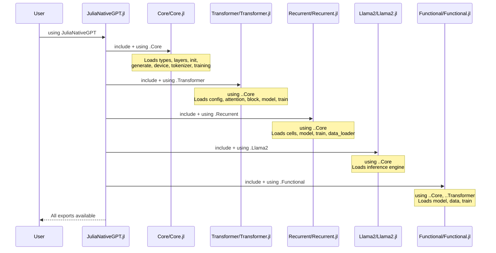

# Design Document: Codebase Refactor

## Overview

The JuliaNativeGPT package has grown organically to support four distinct neural architectures (GPT-2, Recurrent/char-rnn, Llama 2 inference, Functional Autoregressive Transformer) within a single flat `src/` directory of 19 files. While the code is functional and well-documented, the flat structure creates implicit coupling, makes navigation difficult, and hinders independent development of each architecture.

This refactor reorganizes the codebase into a hierarchical submodule structure that mirrors the natural domain boundaries: shared infrastructure (layers, training, generation, device transfer) lives in a `Core` submodule, while each architecture gets its own submodule that depends on Core. The refactor preserves all existing public APIs, type hierarchies, and multiple-dispatch patterns — it is purely structural, not behavioral.

The key design goals are: (1) clear separation of concerns via submodules, (2) explicit dependency direction (architectures depend on Core, never on each other), (3) improved discoverability for new contributors, and (4) a foundation that supports adding new architectures without touching existing code.

## Architecture

### Current State (Flat)

```mermaid
graph TD
    JuliaNativeGPT[JuliaNativeGPT.jl] --> types[types.jl]
    JuliaNativeGPT --> config[config.jl]
    JuliaNativeGPT --> layers[layers.jl]
    JuliaNativeGPT --> attention[attention.jl]
    JuliaNativeGPT --> block[block.jl]
    JuliaNativeGPT --> model[model.jl]
    JuliaNativeGPT --> generate[generate.jl]
    JuliaNativeGPT --> recurrent[recurrent.jl]
    JuliaNativeGPT --> recurrent_model[recurrent_model.jl]
    JuliaNativeGPT --> init[init.jl]
    JuliaNativeGPT --> train[train.jl]
    JuliaNativeGPT --> tokenizer[tokenizer.jl]
    JuliaNativeGPT --> data_loader[data_loader.jl]
    JuliaNativeGPT --> device[device.jl]
    JuliaNativeGPT --> llama2[llama2.jl]
    JuliaNativeGPT --> functional[functional.jl]
    JuliaNativeGPT --> functional_data[functional_data.jl]
    JuliaNativeGPT --> functional_train[functional_train.jl]
```



### Target State (Hierarchical Submodules)

```mermaid
graph TD
    subgraph "Top-Level Module"
        JNG[JuliaNativeGPT.jl]
    end

    subgraph "Core Submodule"
        Core[Core/Core.jl]
        Core --> Types[Core/types.jl]
        Core --> Layers[Core/layers.jl]
        Core --> Init[Core/init.jl]
        Core --> Generate[Core/generate.jl]
        Core --> Device[Core/device.jl]
        Core --> Tokenizer[Core/tokenizer.jl]
        Core --> Training[Core/training.jl]
    end

    subgraph "Transformer Submodule"
        GPT[Transformer/Transformer.jl]
        GPT --> GPTConfig[Transformer/config.jl]
        GPT --> Attention[Transformer/attention.jl]
        GPT --> Block[Transformer/block.jl]
        GPT --> Model[Transformer/model.jl]
        GPT --> GPTTrain[Transformer/train.jl]
    end

    subgraph "Recurrent Submodule"
        RNN[Recurrent/Recurrent.jl]
        RNN --> Cells[Recurrent/cells.jl]
        RNN --> RNNModel[Recurrent/model.jl]
        RNN --> RNNTrain[Recurrent/train.jl]
        RNN --> DataLoader[Recurrent/data_loader.jl]
    end

    subgraph "Llama2 Submodule"
        Llama[Llama2/Llama2.jl]
        Llama --> LlamaInference[Llama2/inference.jl]
    end

    subgraph "Functional Submodule"
        FAT[Functional/Functional.jl]
        FAT --> FATModel[Functional/model.jl]
        FAT --> FATData[Functional/data.jl]
        FAT --> FATTrain[Functional/train.jl]
    end

    JNG --> Core
    JNG --> GPT
    JNG --> RNN
    JNG --> Llama
    JNG --> FAT

    GPT -.->|uses| Core
    RNN -.->|uses| Core
    Llama -.->|uses| Core
    FAT -.->|uses| Core
```



### Target Directory Layout

```
src/
├── JuliaNativeGPT.jl              # Top-level: imports submodules, re-exports public API
├── Core/
│   ├── Core.jl                    # Submodule definition
│   ├── types.jl                   # Abstract type hierarchy
│   ├── layers.jl                  # Embedding, LayerNorm, Linear, CayleyLinear
│   ├── init.jl                    # Shared initialize! dispatches (layers only)
│   ├── generate.jl                # SamplingStrategy hierarchy + sample_next_token
│   ├── device.jl                  # to_device for core layers
│   ├── tokenizer.jl               # CharTokenizer, BPETokenizer
│   └── training.jl                # AdamW, ParamInfo, TrainConfig, TrainState, clip_grad_norm!
├── Transformer/
│   ├── Transformer.jl             # Submodule definition
│   ├── config.jl                  # GPTConfig + MODEL_PRESETS
│   ├── attention.jl               # CausalSelfAttention
│   ├── block.jl                   # TransformerBlock, MLP, gelu
│   ├── model.jl                   # GPTModel + forward
│   ├── init.jl                    # initialize! for GPT-specific types
│   ├── train.jl                   # collect_params(::GPTModel), train!(::GPTModel, ...)
│   └── device.jl                  # to_device for GPT-specific types
├── Recurrent/
│   ├── Recurrent.jl               # Submodule definition
│   ├── config.jl                  # RecurrentConfig
│   ├── cells.jl                   # RNNCell, LSTMCell, GRUCell + states
│   ├── model.jl                   # RecurrentLM + forward/forward_step
│   ├── init.jl                    # initialize! for recurrent types
│   ├── train.jl                   # collect_params(::RecurrentLM), BPTT train!
│   ├── data_loader.jl             # CharDataLoader
│   └── device.jl                  # to_device for recurrent types
├── Llama2/
│   ├── Llama2.jl                  # Submodule definition
│   └── inference.jl               # Full Llama 2 inference engine (self-contained)
└── Functional/
    ├── Functional.jl              # Submodule definition
    ├── config.jl                  # FunctionalConfig
    ├── model.jl                   # FunctionalModel + forward + generate
    ├── data.jl                    # FunctionSequenceLoader + basis evaluation
    ├── init.jl                    # initialize!(::FunctionalModel)
    └── train.jl                   # Zygote AD training loop
```

## Sequence Diagrams

### Module Loading Sequence



### Dependency Flow for Training

```mermaid
sequenceDiagram
    participant User
    participant Train as Architecture.train!
    participant Params as Architecture.collect_params
    participant CoreTrain as Core.Training
    participant Model as Architecture.forward

    User->>Train: train!(model, dataset, config)
    Train->>Params: collect_params(model)
    Params-->>Train: Vector{ParamInfo}
    Train->>CoreTrain: AdamWState(param_infos)
    loop Each iteration
        Train->>Model: forward(model, x; targets=y)
        Model-->>Train: (output, loss)
        Train->>Train: compute gradients
        Train->>CoreTrain: clip_grad_norm!(grads, max_norm)
        Train->>CoreTrain: adamw_step!(params, grads, state, config)
    end
    Train-->>User: TrainState{P}
```

## Components and Interfaces

### Component 1: Core Submodule

**Purpose**: Provides the shared foundation — abstract types, primitive layers, optimizer infrastructure, sampling strategies, device transfer, and tokenization. All architecture submodules depend on Core; Core depends on nothing else in the package.

**Interface**:
```julia
module Core

# Re-exported abstract types
export AbstractGPTConfig, AbstractLayer, AbstractAttention, AbstractBlock
export AbstractRecurrentCell, AbstractRecurrentState

# Layers
export Embedding, LayerNorm, Linear, CayleyLinear, has_bias, cayley_weight

# Initialization (layer-level only)
export initialize!

# Sampling
export SamplingStrategy, GreedySampling, TopKSampling, NucleusSampling
export sample_next_token

# Training infrastructure
export TrainConfig, TrainState, ParamInfo, ParamGroup, DecayGroup, NoDecayGroup
export AdamWState, adamw_step!, clip_grad_norm!, param_group

# Tokenization
export CharTokenizer, BPETokenizer, encode, decode, bpe_merge

# Device transfer (core layers)
export to_device

end
```

**Responsibilities**:
- Define the abstract type hierarchy that all architectures extend
- Provide reusable layer primitives (Embedding, Linear, LayerNorm, CayleyLinear)
- Implement the AdamW optimizer loop mechanics (state, step, clipping)
- Provide sampling strategy dispatch infrastructure
- Handle device transfer for primitive layer types
- Provide tokenizer implementations

### Component 2: Transformer Submodule

**Purpose**: Implements the GPT-2 architecture — configuration, attention, transformer blocks, model assembly, training, and device transfer specific to transformer types.

**Interface**:
```julia
module Transformer

using ..Core

export GPTConfig, MODEL_PRESETS
export CausalSelfAttention
export TransformerBlock, MLP, gelu
export GPTModel, forward
export generate
export collect_params, train!
export initialize!
export to_device

end
```

**Responsibilities**:
- Define GPTConfig with model presets
- Implement CausalSelfAttention (softmax + linearized kernel modes)
- Implement TransformerBlock (pre-norm, residual connections)
- Assemble GPTModel and its forward pass
- Provide `generate` for autoregressive text generation
- Implement `collect_params` for GPT-specific parameter traversal
- Implement `train!` with finite-difference gradients + spectral regularizer
- Extend `initialize!` and `to_device` for GPT-specific composite types

### Component 3: Recurrent Submodule

**Purpose**: Implements char-rnn architectures — RNN/LSTM/GRU cells, multi-layer recurrent LM, BPTT training, and character-level data loading.

**Interface**:
```julia
module Recurrent

using ..Core

export RecurrentConfig
export RNNCell, LSTMCell, GRUCell, RNNState, LSTMState
export RecurrentLM, forward, forward_step, init_state
export CharDataLoader, next_batch!, make_batch_fn
export collect_params, train!
export initialize!
export to_device
export compute_recurrent_spectral_stats

end
```

**Responsibilities**:
- Define recurrent cell types extending AbstractRecurrentCell
- Implement single-timestep forward passes for each cell type
- Assemble RecurrentLM with multi-layer stacking and dropout
- Implement BPTT training with state carry-over
- Provide CharDataLoader for character-level batched data
- Extend `initialize!` (LSTM forget gate bias), `to_device`, `collect_params`

### Component 4: Llama2 Submodule

**Purpose**: Self-contained Llama 2 inference engine ported from llama2.c. Minimal dependencies on Core (only uses sampling strategies and device utilities).

**Interface**:
```julia
module Llama2

using ..Core

export Llama2Config, Llama2Weights, Llama2State, Llama2Transformer
export load_llama2_checkpoint, Llama2Tokenizer, load_llama2_tokenizer

end
```

**Responsibilities**:
- Load and parse Llama 2 checkpoint files
- Implement GQA, RoPE, SwiGLU, KV-cache inference
- Provide greedy/top-k/nucleus generation via Core's sampling strategies
- Load and use Llama 2 tokenizer format

### Component 5: Functional Submodule

**Purpose**: Implements the Functional Autoregressive Transformer — predicting continuous functions instead of discrete tokens. Reuses TransformerBlock from the Transformer submodule.

**Interface**:
```julia
module Functional

using ..Core
using ..Transformer: TransformerBlock, MLP, CausalSelfAttention

export FunctionalConfig, FunctionalModel
export forward, generate
export evaluate_function, differentiate_coeffs, antidifferentiate_coeffs, taylor_coefficients
export FunctionSequenceLoader, next_batch, make_functional_batch_fn
export FunctionalTrainConfig, train!
export initialize!

end
```

**Responsibilities**:
- Define FunctionalConfig (basis_dim replaces vocab_size)
- Assemble FunctionalModel reusing TransformerBlock from Transformer submodule
- Implement coefficient-space forward pass and MSE loss
- Provide basis evaluation (monomial, Fourier, Chebyshev)
- Implement exact coefficient-space operators (differentiation, antidifferentiation, Taylor)
- Provide FunctionSequenceLoader for generating training data
- Implement Zygote AD-based training loop

## Data Models

### File-to-Submodule Mapping

| Current File | Target Submodule | Target File |
|---|---|---|
| `types.jl` | Core | `Core/types.jl` |
| `layers.jl` | Core | `Core/layers.jl` |
| `config.jl` | Transformer | `Transformer/config.jl` |
| `attention.jl` | Transformer | `Transformer/attention.jl` |
| `block.jl` | Transformer | `Transformer/block.jl` |
| `model.jl` | Transformer | `Transformer/model.jl` |
| `generate.jl` (sampling infra) | Core | `Core/generate.jl` |
| `generate.jl` (GPT generate) | Transformer | `Transformer/model.jl` |
| `recurrent.jl` | Recurrent | `Recurrent/cells.jl` |
| `recurrent_model.jl` | Recurrent | `Recurrent/model.jl` |
| `init.jl` (layer inits) | Core | `Core/init.jl` |
| `init.jl` (GPT inits) | Transformer | `Transformer/init.jl` |
| `init.jl` (recurrent inits) | Recurrent | `Recurrent/init.jl` |
| `train.jl` (AdamW, clipping) | Core | `Core/training.jl` |
| `train.jl` (GPT train!) | Transformer | `Transformer/train.jl` |
| `train.jl` (Recurrent train!) | Recurrent | `Recurrent/train.jl` |
| `tokenizer.jl` | Core | `Core/tokenizer.jl` |
| `data_loader.jl` | Recurrent | `Recurrent/data_loader.jl` |
| `device.jl` (core layers) | Core | `Core/device.jl` |
| `device.jl` (GPT types) | Transformer | `Transformer/device.jl` |
| `device.jl` (recurrent types) | Recurrent | `Recurrent/device.jl` |
| `llama2.jl` | Llama2 | `Llama2/inference.jl` |
| `functional.jl` | Functional | `Functional/model.jl` + `Functional/config.jl` |
| `functional_data.jl` | Functional | `Functional/data.jl` |
| `functional_train.jl` | Functional | `Functional/train.jl` |

### Dependency Matrix

| Submodule | Depends On |
|---|---|
| Core | (stdlib only: LinearAlgebra, Random, Statistics) |
| Transformer | Core |
| Recurrent | Core |
| Llama2 | Core (sampling + device only) |
| Functional | Core, Transformer (TransformerBlock reuse) |

## Key Functions with Formal Specifications

### Function 1: Top-Level Module Assembly

```julia
# src/JuliaNativeGPT.jl — the new top-level module file
module JuliaNativeGPT

using LinearAlgebra
using Random
using Statistics
using JSON

# Load submodules in dependency order
include("Core/Core.jl")
include("Transformer/Transformer.jl")
include("Recurrent/Recurrent.jl")
include("Llama2/Llama2.jl")
include("Functional/Functional.jl")

# Bring submodule namespaces into scope
using .Core
using .Transformer
using .Recurrent
using .Llama2
using .Functional

# Re-export everything for backward compatibility
# (users can still do `using JuliaNativeGPT` and get all symbols)
export AbstractGPTConfig, AbstractLayer, AbstractAttention, AbstractBlock
export AbstractRecurrentCell, AbstractRecurrentState
# ... (all existing exports preserved)

end # module
```

**Preconditions:**
- All submodule files exist at their expected paths
- No circular dependencies between submodules
- Core is loaded before any architecture submodule

**Postconditions:**
- All previously exported symbols remain accessible via `using JuliaNativeGPT`
- Submodule-qualified access also works: `JuliaNativeGPT.Core.Linear`
- No behavioral change to any public API

### Function 2: Core Submodule Definition

```julia
# src/Core/Core.jl
module Core

using LinearAlgebra
using Random
using Statistics

# Load in dependency order
include("types.jl")
include("layers.jl")
include("init.jl")
include("generate.jl")
include("device.jl")
include("tokenizer.jl")
include("training.jl")

# Exports
export AbstractGPTConfig, AbstractLayer, AbstractAttention, AbstractBlock
export AbstractRecurrentCell, AbstractRecurrentState
export Embedding, LayerNorm, Linear, CayleyLinear, has_bias, cayley_weight
export initialize!
export SamplingStrategy, GreedySampling, TopKSampling, NucleusSampling
export sample_next_token
export TrainConfig, TrainState, ParamInfo, AdamWState
export adamw_step!, clip_grad_norm!, param_group
export ParamGroup, DecayGroup, NoDecayGroup
export CharTokenizer, BPETokenizer, encode, decode, bpe_merge
export to_device

end # module Core
```

**Preconditions:**
- `types.jl` defines all abstract types before any concrete type references them
- `layers.jl` only depends on abstract types from `types.jl`
- `init.jl` only contains `initialize!` methods for types defined in `layers.jl`

**Postconditions:**
- All abstract types are available for extension by architecture submodules
- All primitive layers can be constructed and used independently
- Training infrastructure (AdamW, clipping) is available without importing any architecture

### Function 3: Architecture Submodule Pattern

```julia
# src/Transformer/Transformer.jl — pattern repeated for each architecture
module Transformer

using ..Core
using ..Core: _softmax, _categorical_sample  # internal helpers if needed

include("config.jl")
include("attention.jl")
include("block.jl")
include("model.jl")
include("init.jl")
include("train.jl")
include("device.jl")

export GPTConfig, MODEL_PRESETS
export CausalSelfAttention
export TransformerBlock, MLP, gelu
export GPTModel, forward, generate
export collect_params, train!
export initialize!
export to_device
export compute_spectral_stats, spectral_regularizer, print_spectral_stats
export measure_preactivation_stats, print_preactivation_stats

end # module Transformer
```

**Preconditions:**
- `..Core` module is already loaded (guaranteed by include order in top-level)
- All types referenced from Core (AbstractLayer, Linear, etc.) are accessible

**Postconditions:**
- GPTModel can be constructed, initialized, trained, and transferred to device
- No symbols from Recurrent, Llama2, or Functional are accessible or needed
- `initialize!` methods extend Core's `initialize!` generic function

**Loop Invariants:** N/A

### Function 4: Splitting `init.jl` Across Submodules

```julia
# Core/init.jl — only layer-level initialization
function initialize!(layer::Embedding{P}; muP::Bool=false) where P ... end
function initialize!(layer::LayerNorm{P}) where P ... end
function initialize!(layer::Linear{P, HB}; std::Real=0.02, muP::Bool=false) where {P, HB} ... end
function initialize!(layer::CayleyLinear{P, HB}; init_scale::Real=1e-3, muP::Bool=false) where {P, HB} ... end
```

```julia
# Transformer/init.jl — GPT-specific composite initialization
function initialize!(layer::CausalSelfAttention{P}; n_layers::Int, muP::Bool=false) where P ... end
function initialize!(layer::MLP{P}; n_layers::Int, muP::Bool=false) where P ... end
function initialize!(block::TransformerBlock{P}; n_layers::Int, muP::Bool=false) where P ... end
function initialize!(model::GPTModel; muP::Bool=false) ... end
```

```julia
# Recurrent/init.jl — recurrent-specific initialization
function initialize!(cell::RNNCell{P}; muP::Bool=false) where P ... end
function initialize!(cell::LSTMCell{P}; muP::Bool=false) where P ... end
function initialize!(cell::GRUCell{P}; muP::Bool=false) where P ... end
function initialize!(model::RecurrentLM; muP::Bool=false) ... end
```

**Preconditions:**
- Core's `initialize!` is defined first (provides the generic function)
- Architecture submodules import `initialize!` from Core to extend it

**Postconditions:**
- Calling `initialize!(model)` dispatches correctly regardless of model type
- Each submodule only knows about its own types
- Adding a new architecture only requires defining new `initialize!` methods

### Function 5: Splitting `train.jl` — Core Training Infrastructure

```julia
# Core/training.jl — optimizer mechanics only, no model-specific code

struct TrainConfig{P<:AbstractFloat}
    learning_rate::P
    weight_decay::P
    max_iters::Int
    grad_clip::P
    batch_size::Int
    betas::Tuple{P, P}
    eps::P
    spectral_lambda::P
    spectral_power_iters::Int
end

struct ParamInfo{P<:AbstractFloat}
    param::AbstractArray{P}
    decay::Bool
end

mutable struct AdamWState{P<:AbstractFloat}
    m::Vector{Array{P}}
    v::Vector{Array{P}}
    t::Int
end

struct TrainState{P<:AbstractFloat}
    losses::Vector{P}
    iter::Int
end

function AdamWState(param_infos::Vector{ParamInfo{P}}) where P ... end
function clip_grad_norm!(grads::Vector, max_norm::P) where P ... end
function adamw_step!(param_infos, grads, state, config) ... end
```

**Preconditions:**
- No dependency on any model type (GPTModel, RecurrentLM, etc.)
- Only depends on AbstractArray and numeric types

**Postconditions:**
- Any architecture can use AdamW by providing its own `collect_params` + gradient computation
- TrainConfig is reusable across all architectures
- Optimizer state management is centralized (single source of truth)

### Function 6: Splitting `device.jl` Across Submodules

```julia
# Core/device.jl — device transfer for primitive layers only
function _cuda_available() ... end
function _to_device_array(x::AbstractArray, device::Symbol) ... end
function to_device(layer::Embedding{P}, device::Symbol) where P ... end
function to_device(layer::LayerNorm{P}, device::Symbol) where P ... end
function to_device(layer::Linear{P, HB}, device::Symbol) where {P, HB} ... end
function to_device(layer::CayleyLinear{P, HB}, device::Symbol) where {P, HB} ... end
```

```julia
# Transformer/device.jl — device transfer for composite GPT types
function to_device(layer::CausalSelfAttention{P}, device::Symbol) where P ... end
function to_device(layer::MLP{P}, device::Symbol) where P ... end
function to_device(block::TransformerBlock{P}, device::Symbol) where P ... end
function to_device(model::GPTModel{P}, device::Symbol) where P ... end
```

```julia
# Recurrent/device.jl — device transfer for recurrent types
function to_device(cell::RNNCell{P}, device::Symbol) where P ... end
function to_device(cell::LSTMCell{P}, device::Symbol) where P ... end
function to_device(cell::GRUCell{P}, device::Symbol) where P ... end
function to_device(model::RecurrentLM{P}, device::Symbol) where P ... end
```

**Preconditions:**
- Core's `to_device` generic and `_to_device_array` helper are defined first
- Architecture submodules extend `to_device` for their own composite types

**Postconditions:**
- `to_device(model, :cuda)` works for any model type via dispatch
- Adding a new architecture only requires new `to_device` methods for its types
- Core's `_cuda_available()` and `_to_device_array` are shared (no duplication)

## Algorithmic Pseudocode

### Main Refactoring Algorithm

```julia
# High-level refactoring procedure (executed by developer/tooling)

function refactor_codebase()
    # Phase 1: Create directory structure
    for submodule in [:Core, :Transformer, :Recurrent, :Llama2, :Functional]
        mkdir("src/$submodule")
    end

    # Phase 2: Extract Core (must be first — others depend on it)
    extract_to("src/types.jl", "src/Core/types.jl")  # verbatim move
    extract_to("src/layers.jl", "src/Core/layers.jl")  # verbatim move
    split_file("src/init.jl", layer_methods => "src/Core/init.jl")
    split_file("src/generate.jl", sampling_infra => "src/Core/generate.jl")
    split_file("src/device.jl", core_layers => "src/Core/device.jl")
    extract_to("src/tokenizer.jl", "src/Core/tokenizer.jl")
    split_file("src/train.jl", optimizer_infra => "src/Core/training.jl")
    write_module_file("src/Core/Core.jl")

    # Phase 3: Extract Transformer
    extract_to("src/config.jl", "src/Transformer/config.jl")
    extract_to("src/attention.jl", "src/Transformer/attention.jl")
    extract_to("src/block.jl", "src/Transformer/block.jl")
    extract_to("src/model.jl", "src/Transformer/model.jl")
    split_file("src/init.jl", gpt_methods => "src/Transformer/init.jl")
    split_file("src/train.jl", gpt_training => "src/Transformer/train.jl")
    split_file("src/device.jl", gpt_types => "src/Transformer/device.jl")
    merge_into("src/generate.jl", gpt_generate => "src/Transformer/model.jl")
    write_module_file("src/Transformer/Transformer.jl")

    # Phase 4: Extract Recurrent
    extract_to("src/recurrent.jl", "src/Recurrent/cells.jl")
    extract_to("src/recurrent_model.jl", "src/Recurrent/model.jl")
    extract_to("src/data_loader.jl", "src/Recurrent/data_loader.jl")
    split_file("src/init.jl", recurrent_methods => "src/Recurrent/init.jl")
    split_file("src/train.jl", recurrent_training => "src/Recurrent/train.jl")
    split_file("src/device.jl", recurrent_types => "src/Recurrent/device.jl")
    write_module_file("src/Recurrent/Recurrent.jl")

    # Phase 5: Extract Llama2
    extract_to("src/llama2.jl", "src/Llama2/inference.jl")
    write_module_file("src/Llama2/Llama2.jl")

    # Phase 6: Extract Functional
    split_file("src/functional.jl", config => "src/Functional/config.jl")
    split_file("src/functional.jl", model_and_forward => "src/Functional/model.jl")
    extract_to("src/functional_data.jl", "src/Functional/data.jl")
    extract_to("src/functional_train.jl", "src/Functional/train.jl")
    write_module_file("src/Functional/Functional.jl")

    # Phase 7: Rewrite top-level module
    rewrite("src/JuliaNativeGPT.jl")  # include submodules, re-export

    # Phase 8: Update tests
    # Tests should continue to work unchanged (using JuliaNativeGPT)
    # Optionally add submodule-specific test files

    # Phase 9: Remove old flat files
    for old_file in old_flat_files
        rm("src/$old_file")
    end
end
```

### File Splitting Algorithm

```julia
# Algorithm for splitting a file that contains code for multiple submodules
# Example: init.jl contains methods for Embedding, Linear (Core), GPTModel (Transformer), RNNCell (Recurrent)

function split_file(source_path, assignments::Dict{Symbol, String})
    source = read(source_path, String)
    functions = parse_function_blocks(source)  # extract each function definition

    for func in functions
        # Determine target based on the dispatched type in the signature
        target_type = extract_dispatch_type(func.signature)
        target_submodule = classify_type(target_type)
        # target_submodule ∈ {:Core, :Transformer, :Recurrent, :Functional}

        target_path = assignments[target_submodule]
        append_to_file(target_path, func.full_text)
    end
end

function classify_type(type_name::Symbol)::Symbol
    core_types = [:Embedding, :LayerNorm, :Linear, :CayleyLinear]
    transformer_types = [:CausalSelfAttention, :MLP, :TransformerBlock, :GPTModel]
    recurrent_types = [:RNNCell, :LSTMCell, :GRUCell, :RecurrentLM]
    functional_types = [:FunctionalModel]

    type_name ∈ core_types && return :Core
    type_name ∈ transformer_types && return :Transformer
    type_name ∈ recurrent_types && return :Recurrent
    type_name ∈ functional_types && return :Functional
    error("Unknown type: $type_name")
end
```

**Preconditions:**
- Source file is valid Julia with well-separated function definitions
- Each function dispatches on exactly one primary type
- Type classification covers all types in the codebase

**Postconditions:**
- Every function from the source file appears in exactly one target file
- No function is duplicated across submodules
- No function is lost during the split

**Loop Invariants:**
- After processing each function: total functions assigned == functions processed so far

## Example Usage

### After Refactoring — User-Facing API (Unchanged)

```julia
# All existing code continues to work without modification
using JuliaNativeGPT

config = GPTConfig{Float32}(model_type=:gpt_nano, vocab_size=100, block_size=32)
model = GPTModel(config)
initialize!(model; muP=true)
model = to_device(model, :cuda)

# Training
train_config = TrainConfig{Float32}(learning_rate=1f-3, max_iters=200)
state = train!(model, make_batch_fn, train_config)

# Generation
output = generate(model, prompt; strategy=TopKSampling(10, 0.8f0), max_new_tokens=50)
```

### After Refactoring — Submodule-Qualified Access (New Capability)

```julia
# Power users can import specific submodules for clarity
using JuliaNativeGPT.Core: Linear, LayerNorm, Embedding
using JuliaNativeGPT.Transformer: GPTModel, GPTConfig
using JuliaNativeGPT.Functional: FunctionalModel, FunctionalConfig

# Or use qualified names
model = JuliaNativeGPT.Transformer.GPTModel(config)
```

### After Refactoring — Adding a New Architecture

```julia
# src/NewArch/NewArch.jl
module NewArch

using ..Core
using ..Core: AbstractLayer, Linear, initialize!, to_device

# Define new types
struct NewArchConfig{P} <: AbstractGPTConfig{P}
    # ...
end

struct NewArchModel{P}
    # reuse Linear, Embedding from Core
    encoder::Linear{P, true}
    # ...
end

# Extend shared generic functions
function initialize!(model::NewArchModel; muP::Bool=false)
    initialize!(model.encoder; muP=muP)
    # ...
end

function Core.to_device(model::NewArchModel{P}, device::Symbol) where P
    # ...
end

export NewArchConfig, NewArchModel

end # module NewArch
```

## Correctness Properties

The refactoring must satisfy these invariants:

### Property 1: API Preservation
∀ symbol `s` exported by the current `JuliaNativeGPT` module, `s` remains exported after refactoring. No user code that does `using JuliaNativeGPT` should break.

### Property 2: Behavioral Equivalence
∀ model type `M`, ∀ input `x`, `forward(model::M, x)` produces identical output before and after refactoring (bit-for-bit, given same RNG state).

### Property 3: Dispatch Correctness
∀ generic function `f` (initialize!, to_device, collect_params, train!), all method signatures that existed before refactoring continue to dispatch correctly. No method ambiguities are introduced.

### Property 4: Dependency Acyclicity
The submodule dependency graph is a DAG. Specifically: Core depends on nothing internal; Transformer, Recurrent, Llama2 depend only on Core; Functional depends on Core and Transformer. No cycles exist.

### Property 5: No Duplication
∀ function definition `d` in the current codebase, `d` appears in exactly one file after refactoring. Shared infrastructure lives in Core; architecture-specific code lives in its submodule.

### Property 6: Test Continuity
All existing tests pass without modification (they use `using JuliaNativeGPT` which re-exports everything).

### Property 7: Type Hierarchy Preservation
The abstract type hierarchy (`AbstractLayer → AbstractAttention`, `AbstractLayer → AbstractBlock`, `AbstractLayer → AbstractRecurrentCell`) remains unchanged. Parametric type relationships are preserved.

## Error Handling

### Error Scenario 1: Circular Dependency

**Condition**: A submodule tries to use a type defined in another non-Core submodule (e.g., Recurrent importing from Transformer).
**Response**: Julia will throw an `UndefVarError` at module load time.
**Prevention**: The design enforces that architecture submodules only depend on Core. The one exception (Functional using TransformerBlock) is explicitly handled via `using ..Transformer`.
**Recovery**: Move the shared type to Core, or restructure the dependency.

### Error Scenario 2: Missing Export After Split

**Condition**: A symbol that was previously accessible via `using JuliaNativeGPT` is no longer exported because it wasn't re-exported from the submodule chain.
**Response**: User code throws `UndefVarError` when trying to use the symbol.
**Prevention**: The top-level module explicitly re-exports all symbols from all submodules. A verification step compares exports before/after.
**Recovery**: Add the missing symbol to the appropriate submodule's export list and the top-level re-export.

### Error Scenario 3: Method Ambiguity After Split

**Condition**: Splitting `initialize!` across submodules introduces method ambiguity if both Core and an architecture define methods that could match the same call.
**Response**: Julia throws a `MethodError` about ambiguous methods.
**Prevention**: Core only defines `initialize!` for primitive layer types (Embedding, Linear, etc.). Architecture submodules define it for composite types (GPTModel, RecurrentLM). These never overlap because the dispatch types are distinct.
**Recovery**: Add a more specific method to resolve the ambiguity.

## Testing Strategy

### Unit Testing Approach

Existing tests (`test/test_*.jl`) should pass without modification since they use `using JuliaNativeGPT` which re-exports all symbols. This is the primary correctness gate.

Additionally, add a new test file to verify the submodule structure:

```julia
# test/test_submodules.jl
using JuliaNativeGPT
using Test

@testset "Submodule Structure" begin
    # Verify submodules exist and are accessible
    @test isdefined(JuliaNativeGPT, :Core)
    @test isdefined(JuliaNativeGPT, :Transformer)
    @test isdefined(JuliaNativeGPT, :Recurrent)
    @test isdefined(JuliaNativeGPT, :Llama2)
    @test isdefined(JuliaNativeGPT, :Functional)

    # Verify qualified access works
    @test JuliaNativeGPT.Core.Linear === Linear
    @test JuliaNativeGPT.Transformer.GPTModel === GPTModel
    @test JuliaNativeGPT.Recurrent.LSTMCell === LSTMCell
end

@testset "Export Completeness" begin
    # Snapshot of all symbols that must remain exported
    required_exports = [
        :AbstractGPTConfig, :AbstractLayer, :AbstractAttention, :AbstractBlock,
        :AbstractRecurrentCell, :AbstractRecurrentState,
        :GPTConfig, :MODEL_PRESETS, :RecurrentConfig,
        :Embedding, :LayerNorm, :Linear, :has_bias,
        :CausalSelfAttention, :TransformerBlock, :MLP, :gelu,
        :GPTModel, :forward,
        :RNNCell, :LSTMCell, :GRUCell, :RNNState, :LSTMState,
        :RecurrentLM, :forward_step, :init_state,
        :initialize!,
        :SamplingStrategy, :GreedySampling, :TopKSampling, :NucleusSampling,
        :generate, :sample_next_token,
        :TrainConfig, :train!, :TrainState, :collect_params,
        :CharTokenizer, :BPETokenizer, :encode, :decode,
        :CharDataLoader, :next_batch!, :make_batch_fn,
        :to_device,
        :Llama2Config, :Llama2Weights, :Llama2State, :Llama2Transformer,
        :FunctionalConfig, :FunctionalModel,
        :evaluate_function, :FunctionalTrainConfig,
        :FunctionSequenceLoader, :next_batch,
        :differentiate_coeffs, :antidifferentiate_coeffs, :taylor_coefficients,
    ]
    for sym in required_exports
        @test sym ∈ names(JuliaNativeGPT)
    end
end
```

### Property-Based Testing Approach

**Property Test Library**: None required for this refactoring. The correctness properties are structural (export lists, dispatch tables) rather than behavioral. Existing tests cover behavioral correctness.

### Integration Testing Approach

Run the full existing test suite as the integration gate:

```bash
julia --project -e 'using Pkg; Pkg.test()'
```

All 9 existing test files must pass without modification. This validates that the refactoring is purely structural and introduces no behavioral regressions.

## Performance Considerations

This refactoring is purely structural — it reorganizes code into submodules without changing any algorithms, data structures, or computation paths. Performance characteristics:

- **Compile time**: Julia's module system compiles each submodule independently. First-load time may increase slightly due to additional module boundaries, but subsequent loads benefit from better precompilation granularity.
- **Runtime**: Zero performance impact. Julia's multiple dispatch resolves methods at compile time regardless of which module defines them. Method tables are global.
- **Memory**: No change. Submodules share the same address space and type system.

## Security Considerations

No security implications. This is a pure code organization refactoring with no changes to:
- File I/O patterns (checkpoint loading, tokenizer loading)
- Network operations (none exist)
- User input handling
- Dependency versions

## Dependencies

No new dependencies are introduced. The existing dependency set remains:
- LinearAlgebra (stdlib)
- Random (stdlib)
- Statistics (stdlib)
- JSON
- Zygote.jl (used only by Functional submodule)
- CUDA.jl (optional, used by Core/device.jl)
- Flux (used for gradient utilities)

The refactoring may enable future dependency isolation (e.g., Zygote only loaded when Functional submodule is used), but that optimization is out of scope for this iteration.
