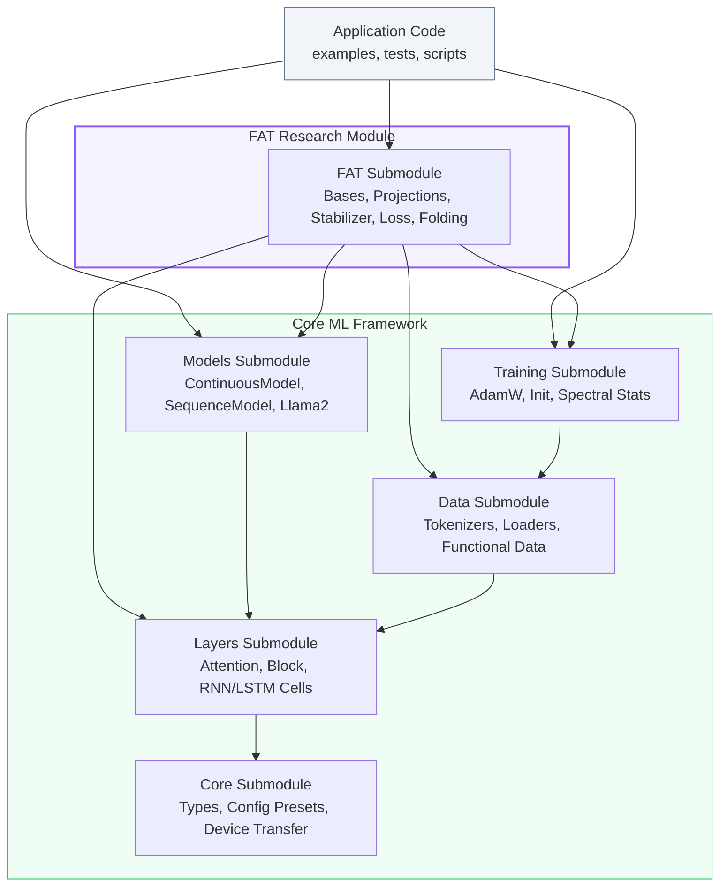

# Architecture Guide — Architect.jl

## Overview

Architect.jl is organized as a **modular, layered ML framework** built on Julia's parametric type system and multiple dispatch. The architecture follows a clear dependency hierarchy:

```
Core (types, configs, device management)
  ├── Layers (basic building blocks)
  ├── Models (high-level models)
  ├── Data (tokenizers and data loaders)
  ├── Training (optimization and initialization)
  └── FAT (operator learning research module)
```

This document explains how these modules interact and why they're organized this way.

---

## Module Hierarchy

### 1. Core Module (`src/Core/`)

**Responsibility**: Type definitions, configurations, and cross-cutting concerns.

**Files**:
- `types.jl`: Abstract type hierarchy (`AbstractLayer{P}`, `AbstractAttention{P}`, `AbstractRecurrentCell{P}`, etc.)
- `config.jl`: `ModelConfig` struct with model presets (gpt_nano through gpt2_xl)
- `device.jl`: Device transfer abstraction via `Core.to_device(x, device::Symbol)`

**Key Exports**:
```julia
# Abstract types
AbstractModelConfig, AbstractLayer, AbstractAttention, AbstractBlock
AbstractRecurrentCell, AbstractRecurrentState

# Concrete types
ModelConfig

# Functions
to_device(x, device::Symbol)  # Generic array transfer
```

**Design Pattern**: Core provides the **common language** all submodules speak:
- All layer types inherit from `AbstractLayer{P}` where `P <: AbstractFloat`
- All configs inherit from `AbstractModelConfig{P}`
- Device transfer is centralized via a generic function with type-specific implementations

---

### 2. Layers Module (`src/Layers/`)

**Responsibility**: Basic neural network layers and building blocks.

**Files**:
- `layer_utils.jl`: `Embedding`, `Norm` (LayerNorm), `Linear`, `OrthogonalLinear`
- `attention.jl`: Multi-head causal self-attention with RoPE and optional RFF
- `transformer_block.jl`: `FeedForward` (SwiGLU-style) and `Block` (transformer block)
- `recurrent.jl`: `RNNCell`, `LSTMCell`, `GRUCell` and their state types

**Key Exports**:
```julia
# Layer types
Embedding, Norm, Linear, OrthogonalLinear
Attention, FeedForward, Block
RNNCell, LSTMCell, GRUCell

# State types
RNNState, LSTMState

# Functions
has_bias(layer::Linear)
orthogonal_weight(shape)
initialize!(layer)
to_device(layer, device::Symbol)  # Per-layer implementations
```

**Design Patterns**:
- **Parametric types**: `Embedding{P, M<:AbstractMatrix{P}}` carries both the precision type and matrix type
- **Dispatch-based**: Different `initialize!` methods for each layer type
- **Device-aware**: Each layer implements `Core.to_device` to recursively transfer its arrays
- **Pre-norm**: Transformer blocks use LayerNorm before attention/MLP (GPT-2 style)

---

### 3. Models Module (`src/Models/`)

**Responsibility**: High-level model architectures combining layers.

**Files**:
- `generate.jl`: Sampling strategies (`GreedySampling`, `TopKSampling`, `NucleusSampling`) and generation logic
- `continuous_model.jl`: `ContinuousModel` (Transformer-based GPT)
- `sequence_model.jl`: `SequenceModel` (recurrent LM with stacked cells)
- `llama2_inference.jl`: `Llama2Transformer` — pure Julia port of llama2.c

**Key Exports**:
```julia
# Config types
ContinuousConfig, SequenceConfig, Llama2Config

# Model types
ContinuousModel, SequenceModel, Llama2Transformer

# Sampling
SamplingStrategy, GreedySampling, TopKSampling, NucleusSampling

# Functions
generate(model, prompt; strategy=..., max_new_tokens=...)
sample_next_token(model, logits; strategy)
evaluate_function(coeffs, x; basis)  # For functional models
to_device(model, device::Symbol)
```

**Design Patterns**:
- **Composition**: Models compose layers (embeddings, attention blocks, output heads)
- **Dispatch for sampling**: Different `sample_next_token` implementations for each strategy
- **Device transparency**: `to_device(model, device)` recursively transfers all sub-layers
- **Mutation-free forward pass**: Entire generation is Zygote-differentiable (for FAT training)

---

### 4. Data Module (`src/Data/`)

**Responsibility**: Tokenization and data loading.

**Files**:
- `tokenizer.jl`: `CharTokenizer` (character-level) and `BPETokenizer` (GPT-2 BPE)
- `char_data_loader.jl`: `CharDataLoader` with train/val/test splits and batching
- `functional_data.jl`: `FunctionSequenceLoader` for derivative/integral/composition tasks

**Key Exports**:
```julia
# Tokenizer types
CharTokenizer, BPETokenizer

# Functions
encode(tokenizer, text::String) -> Vector{Int}
decode(tokenizer, ids::Vector{Int}) -> String
bpe_merge(tokenizer, token::String) -> String

# Data loaders
CharDataLoader
FunctionSequenceLoader

# Functions
next_batch!(loader)
next_batch(loader)  # Immutable version for functional training
make_batch_fn(loader)

# Mathematical operations
differentiate_coeffs(c::AbstractVector)
antidifferentiate_coeffs(c; C=0)
taylor_coefficients(f_sym::Symbol, degree::Int, ::Type{P})
```

**Design Patterns**:
- **Immutable data loading**: `FunctionSequenceLoader` uses functional API (`next_batch`) for Zygote compatibility
- **Mutable data loading**: `CharDataLoader` uses mutating API (`next_batch!`) for efficiency in classical training
- **Type flexibility**: Loaders are parameterized on precision type `P`

---

### 5. Training Module (`src/Training/`)

**Responsibility**: Optimization, initialization, and training loops.

**Files**:
- `train.jl`: AdamW optimizer and classical training loop for `ContinuousModel` and `SequenceModel`
- `functional_train.jl`: Zygote AD-based training for `ContinuousModel` (functional regression)
- `init.jl`: Dispatch-based weight initialization (GPT-2 conventions + µP support)

**Key Exports**:
```julia
# Config types
TrainConfig, ContinuousTrainConfig

# Optimizer
AdamWState

# Functions
train!(model, dataset, config)
initialize!(model; muP=false)
collect_params(model) -> Vector{ParamInfo}

# Utilities
clip_grad_norm!(grads, max_norm)
power_iteration(W) -> σ_max
compute_spectral_stats(model)
spectral_regularizer(model; λ, power_iters)
```

**Design Patterns**:
- **Dispatch for initialization**: Each layer type has its own `initialize!` method
- **Parameter collection**: `collect_params` flattens model parameters into a vector with metadata (group, shape)
- **Spectral monitoring**: Power iteration estimates largest singular value of weight matrices
- **Two training paradigms**: Classical (finite differences) for discrete models, Zygote AD for functional models
- **Gradient clipping**: Norm-based clipping prevents gradient explosion

---

### 6. FAT Module (`src/FAT/`)

**Responsibility**: Core research implementation of the Functional Autoregressive Transformer (FAT), functional bases, stabilizers, loss formulations, and head pruning/folding.

**Files**:
- `phase1_hilbert.jl`: Mathematical foundations of Chebyshev bases, projections, and evaluation.
- `phase2_spectral_head.jl`: `SpectralHead` layer for mapping representations between hidden dimensions and basis spaces.
- `phase3_stabilizer.jl`: Enforces non-expansivity ($L_{\Pi} \le 1$) using Chebyshev-only projections.
- `phase4_loss.jl`: Directional trajectory approval loss + MSE warmup.
- `phase5_fat_model.jl`: High-level wrapper and AD-safe functional training loop.
- `phase6_data.jl`: Functional data loading/batching.
- `phase7_mla.jl`: Multi-Head Latent Attention (MLA) adaptation.
- `phase8_hardin_taylor.jl`: Hardin-Taylor Minimum-Complexity Prediction (MCP) regularizers.
- `folding.jl`: Topological folding, CKA head similarity tracking, and soft-merging.

**Design Patterns**:
- **Purely Functional Operations**: The entire forward pass, loss computation, and stabilization cascade are written without in-place array mutation to remain fully compatible with Zygote automatic differentiation.
- **Dynamic Intrusion (TrackedAttention)**: For architectural analysis such as topological folding, the module dynamically wraps existing attention blocks in a tracked subtype of `AbstractAttention` using a wrap/unwrap pattern to gather activation stats without altering model definition.

---

## Cross-Module Interactions

### Device Transfer Pattern

Device transfer is a **cross-cutting concern** that every layer must support:

```
User code:                     model = to_device(model, :cuda)
                                      ↓
Main orchestrator:             Core.to_device(model, device)
                                      ↓
Model dispatches:              Models.to_device(model::ContinuousModel, device)
                                      ↓
Recursively transfers layers:  to_device(model.coeff_encoder, device)
                               to_device.(model.blocks, device)
                               to_device(model.ln_f, device)
                               to_device(model.coeff_head, device)
                                      ↓
Each layer transfers arrays:   Core.to_device(layer::Linear, device)
                                      ↓
Array transfer happens:        Core.to_device(layer.weight, device)
                               Core.to_device(layer.bias, device)
```

**Implementation in Core**:
```julia
# Generic array transfer
function to_device(x::AbstractArray, device::Symbol)
    if device == :cpu
        return Array(x)
    elseif device == :cuda && _cuda_available()
        return cu(x)
    else
        error("Device $(device) not available")
    end
end

# Strict fallback for unsupported types
function to_device(x, device::Symbol)
    error("to_device not implemented for type $(typeof(x))")
end
```

**Implementation in Layers** (example):
```julia
function Core.to_device(linear::Linear{P, HB}, device::Symbol) where {P, HB}
    return Linear{P, HB}(
        Core.to_device(linear.weight, device),
        Core.to_device(linear.bias, device)
    )
end
```

### Dispatch-Based Initialization

Weight initialization is tailored to each layer type:

```julia
# In Training module
initialize!(emb::Embedding{P}) where P
    # Uniform init for embedding weight

initialize!(linear::Linear{P}) where P
    # Normal(0, 0.02) for in-layer weights
    # Zero for biases

initialize!(attn::Attention{P}) where P
    # Scaled projection initialization
    # Special handling for output projection

initialize!(block::Block{P}) where P
    # Init sub-layers recursively
    # Scale output projection by 1/√(2N)
```

Users just call `initialize!(model)` — dispatch handles the details.

---

## Type Parameter Conventions

All types in Architect.jl follow this convention:

```julia
struct MyLayer{P, ...other params...} <: AbstractLayer{P}
    weight::AbstractMatrix{P}
    bias::AbstractVector{P}
end
```

**Why?**
- `P` is always the floating-point precision type (`Float32`, `Float64`, etc.)
- Enables **generic arithmetic**: operations on `Float32` and `Float64` models compile separately
- Allows **specialization**: CUDA kernels use the right precision automatically
- Supports **mixed precision**: future support for `Float16` training via type params

---

## Dependency Graph



**Key principle**: Lower modules don't depend on higher modules. Core depends on nothing in Architect (only Julia stdlib).

---

## Extending Architect.jl

### Adding a New Layer Type

1. **Define struct** in `Layers/`:
   ```julia
   struct MyLayer{P} <: AbstractLayer{P}
       weight::AbstractMatrix{P}
   end
   ```

2. **Implement forward pass**:
   ```julia
   function (layer::MyLayer{P})(x::AbstractArray{P}) where P
       return layer.weight * x
   end
   ```

3. **Implement initialization** in `Training/init.jl`:
   ```julia
   function initialize!(layer::MyLayer{P}; muP=false) where P
       randn!(layer.weight)
       layer.weight ./= sqrt(size(layer.weight, 1))
   end
   ```

4. **Implement device transfer** in `Layers/`:
   ```julia
   function Core.to_device(layer::MyLayer{P}, device::Symbol) where P
       return MyLayer{P}(Core.to_device(layer.weight, device))
   end
   ```

5. **Export** from `Layers/Layers.jl`:
   ```julia
   export MyLayer
   ```

### Adding a New Model

1. **Define struct** in `Models/`:
   ```julia
   struct MyModel{P} <: AbstractModel{P}
       layers::Vector{AbstractLayer{P}}
   end
   ```

2. **Implement forward pass**:
   ```julia
   function (model::MyModel{P})(x::AbstractArray{P}) where P
       # Forward logic
   end
   ```

3. **Implement device transfer**:
   ```julia
   function Core.to_device(model::MyModel{P}, device::Symbol) where P
       return MyModel{P}(to_device.(model.layers, device))
   end
   ```

4. **Implement generation** (optional):
   ```julia
   function generate(model::MyModel{P}, prompt; kwargs...) where P
       # Generation logic
   end
   ```

---

## Performance Considerations

### Memory Layout

- **Column-major**: All arrays use Julia's native column-major layout (Fortran-order)
- **Why**: Better cache locality in matrix operations and GPU transfer
- **Impact**: No explicit transpose; just reshape with proper interpretation

### Mutation vs. Immutability

- **Classical training** (`CharDataLoader`, `train!`): Uses mutation (`next_batch!`, `mul!`) for efficiency
- **Functional training** (Zygote AD): Pure functions (`next_batch`, no `setindex!`) for differentiability
- **Design trade-off**: Classical training is ~2-3× faster; functional training enables automatic differentiation

### Device Transfer

- **Lazy**: Devices are only transferred when `to_device` is called
- **Recursive**: Single call transfers entire model recursively
- **Type-safe**: Trying to transfer unsupported types raises an error immediately

---

## Testing Strategy

Each module has corresponding tests:

| Module | Test File | Coverage |
|--------|-----------|----------|
| Core | (implicit in other tests) | Type hierarchy, configs |
| Layers | test_layers.jl, test_attention.jl | Layer forward pass, initialization |
| Models | test_model.jl, test_llama2.jl | Model forward, generation |
| Data | test_tokenizer.jl | Encoding/decoding, round-trip |
| Training | test_train.jl | Gradient computation, loss |

**Testing philosophy**: Test public APIs; implementation details are private.

---

## Future Extensions

- **Quantization**: Type-safe `Float16` support via type parameters
- **Custom layers**: Plug-in architecture for domain-specific layers
- **Distributed training**: Extend `to_device` to multi-GPU and multi-node
- **Checkpointing**: Serialize models via type-stable structs
- **AutoDiff optimizations**: Integrate Enzyme.jl for faster gradients
